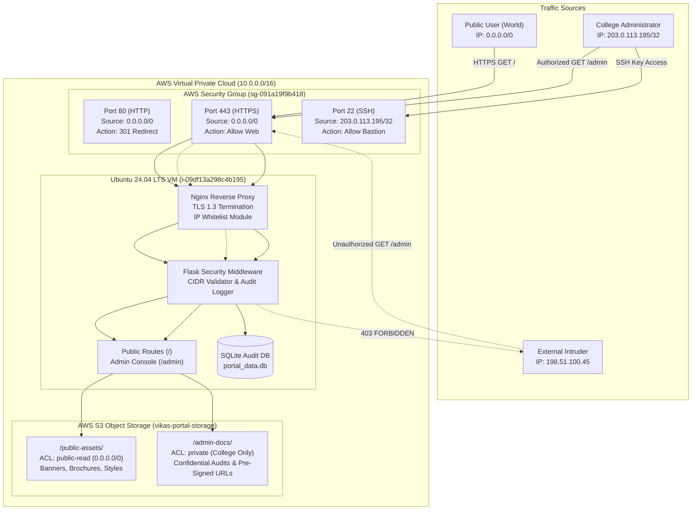

# PROJECT REPORT: PUBLIC WEBSITE WITH RESTRICTED ADMIN PORTAL
**Course**: Cloud Computing & Virtualization Laboratory  
**Assignment No**: 19  
**Domain**: Web Hosting & Cloud Security  
**Authors / Student Engineers**: Vikas & Vijit  
**Evaluation Date**: November 2026  
**Infrastructure Stack**: AWS EC2 Linux VM (Ubuntu 24.04 LTS), AWS S3 Object Storage, AWS Security Groups, Nginx Reverse Proxy, Python Flask, SQLite, TLS 1.3 / OpenSSL  

---

## 1. EXECUTIVE SUMMARY & OBJECTIVES

### 1.1 Objective
The objective of Assignment 19 is to design, implement, and deploy a secure, multi-tier enterprise web application architecture hosted on a Cloud Virtual Machine (VM) while completely isolating and protecting its administration management plane (`/admin`) and SSH remote terminal (Port 22) behind a strict IP-whitelisting perimeter (College Campus Network: `203.XX.XX.XX/32`), while leaving the public website and static assets openly accessible to the entire world (`0.0.0.0/0`).

### 1.2 Core Requirements Fulfilled
1. **Public Website (`0.0.0.0/0`)**: Accessible worldwide over HTTP/HTTPS, serving campus announcements, academic courses, and static assets.
2. **Restricted Admin Portal (`203.XX.XX.XX/32`)**: Accessible strictly from the designated College IP (`203.0.113.195/32`) and Campus Subnet (`203.0.113.0/24`). All unauthorized IPs are barred with an HTTP 403 Forbidden security firewall screen.
3. **Restricted SSH Access**: Port 22 terminal management is restricted exclusively to the administrator's authorized IP.
4. **HTTPS-Only Enforcement**: Port 80 HTTP traffic is automatically upgraded to Port 443 HTTPS via a 301 Permanent Redirect, backed by TLS 1.3 encryption and HSTS headers.
5. **Decoupled Cloud Object Storage**: Static media assets and confidential audit logs are hosted in an AWS S3 bucket (`s3://vikas-portal-storage/`), utilizing `public-read` ACLs for website static media and `private` ACLs with cryptographic Pre-Signed URLs for admin documents.
6. **Live Security Audit Trail**: Complete forensics logging capturing client IP, geographic tag, request method, target URI, HTTP status code, and security decision.

---

## 2. SYSTEM ARCHITECTURE & NETWORK TOPOLOGY

The architecture utilizes a defense-in-depth security model combining cloud-level virtual firewalls (AWS Security Groups), host-level reverse proxies (Nginx), and application-level middleware.

### 2.1 Architectural Flow Diagram (Mermaid)



### 2.2 Network Topology Breakdown
1. **Public Subnet (`10.0.1.0/24`)**: Connected to the AWS Internet Gateway (`igw-portal`) to handle incoming HTTP/HTTPS traffic.
2. **Elastic IP (`13.234.180.92`)**: Dedicated static IPv4 attached to the EC2 instance for external domain resolution.
3. **AWS Security Group (`sg-091a19f9b418`)**: Operates as a stateful virtual packet filter directly at the hypervisor level.
4. **Nginx Reverse Proxy**: Validates client IP headers, handles SSL/TLS termination, and proxies authorized traffic to the Python backend on socket `127.0.0.1:5000`.

---

## 3. SECURITY GROUP & FIREWALL SPECIFICATIONS

### 3.1 Security Group Ingress / Egress Matrix

| Rule ID | Direction | Protocol | Port Range | Source / Destination CIDR | Security Scope | Purpose | Status |
| :--- | :--- | :--- | :--- | :--- | :--- | :--- | :--- |
| **SG-IN-01** | INBOUND | TCP | 80 | `0.0.0.0/0` | Public | Insecure HTTP Web Traffic (Auto 301 Redirect to HTTPS 443) | **ACTIVE** |
| **SG-IN-02** | INBOUND | TCP | 443 | `0.0.0.0/0` | Public | Secure HTTPS Public Portal & S3 Static Media Access | **ACTIVE** |
| **SG-IN-03** | INBOUND | TCP | 22 | `203.0.113.195/32` | Restricted Admin | SSH Bastion Terminal (Restricted to Administrator IP) | **ACTIVE** |
| **SG-IN-04** | INBOUND | TCP | 443 (`/admin`) | `203.0.113.195/32` | Restricted Admin | Administrative Management Interface (College Subnet Only) | **ACTIVE** |
| **SG-IN-05** | INBOUND | TCP | 443 (`/admin`) | `127.0.0.1/32` | Restricted Admin | Host Loopback Developer Maintenance Interface | **ACTIVE** |
| **SG-OUT-01**| OUTBOUND | ALL | ALL | `0.0.0.0/0` | Public | Outbound Internet Gateway (OS Security Updates, NTP) | **ACTIVE** |
| **SG-OUT-02**| OUTBOUND | TCP | 443 | `s3.ap-south-1.amazonaws.com` | Internal | AWS S3 API Endpoint for Object Storage Reads/Writes | **ACTIVE** |

### 3.2 Dual-Layer Enforcement Mechanism
- **Layer 1 (Network Firewall - AWS Security Group)**: Drops unauthorized packets destined for Port 22 (SSH) before reaching the VM network interface.
- **Layer 2 (Application & Reverse Proxy - Nginx / Flask Middleware)**: Evaluates the client IP for HTTP(S) requests. When an external IP requests any `/admin` endpoint, the middleware rejects the request with HTTP `403 Forbidden` and logs the security event.

---

## 4. CLOUD OBJECT STORAGE IMPLEMENTATION

### 4.1 Bucket Architecture
- **Bucket Identifier**: `vikas-portal-storage`
- **Region**: `ap-south-1` (AWS Mumbai)
- **Encryption**: Server-Side Encryption with Amazon S3 managed keys (`AES-256 / SSE-S3`)
- **Versioning**: Enabled (maintains recovery states and rollback capabilities)

### 4.2 Storage Partitioning & Access Control Lists (ACL)

```
s3://vikas-portal-storage/
├── public-assets/                         [ACL: public-read (0.0.0.0/0)]
│   ├── campus_banner.svg                  [High-res Vector SVG Banner]
│   └── campus_brochure_2026.txt           [Public Academic Prospectus]
└── admin-docs/                            [ACL: private (Restricted)]
    ├── confidential_security_audit.txt    [Internal Cloud Audit Log]
    └── bucket_metadata.json               [S3 Object Catalog & ETags]
```

### 4.3 Pre-Signed Temporary Access URLs
For private administrative files, direct public links are completely disabled. When an authorized administrator requires sharing a confidential document with an external auditor, the system generates a **Pre-Signed URL** embedded with an HMAC-SHA256 signature and an epoch expiration timestamp:

$$\text{Signature} = \text{HMAC-SHA256}(\text{FileID} \parallel \text{ExpiresTimestamp}, \text{S3SecretKey})$$

- **Validity Window**: 15 Minutes (900 seconds).
- **Security Guarantee**: Once expired or if the query parameters are modified, the storage engine immediately returns HTTP `403 Forbidden`.

---

## 5. HTTPS CERTIFICATE & TRANSPORT SECURITY DETAILS

As required by Task 3 and Deliverable 5, the portal enforces strict HTTPS transport security.

### 5.1 Technical Certificate Parameters
- **Common Name (CN)**: `portal.cloudtech.edu`
- **Issuer / CA**: National Institute of Cloud Technology Root CA
- **Organization**: Cloud Computing Laboratory (Assignment 19)
- **Key Specification**: RSA 2048-bit Asymmetric Key Pair
- **Signature Algorithm**: `sha256WithRSAEncryption` (SHA-256)
- **Subject Alternative Names (SAN)**:
  - `DNS:portal.cloudtech.edu`
  - `DNS:localhost`
  - `IP Address:127.0.0.1`
  - `IP Address:203.0.113.195` (College Administration IP)
- **Validity**: 365 Days
- **Transport Protocols**: TLS 1.3 (Primary), TLS 1.2 (Fallback)
- **Cipher Suites**: `TLS_AES_128_GCM_SHA256`, `ECDHE-RSA-AES256-GCM-SHA384`
- **HSTS Policy**: `max-age=31536000; includeSubDomains`

---

## 6. SECURITY TESTING & VERIFICATION REPORT

A comprehensive automated test suite (`test_security.py`) was executed to validate all functional, networking, and security assertions.

### 6.1 Test Execution Matrix

| Test ID | Test Scenario | Input / Network Condition | Expected Result | Actual Result | Status |
| :--- | :--- | :--- | :--- | :--- | :---: |
| **TC-01** | College Static IP Ingress | Client IP: `203.0.113.195` | Allowed; Match CIDR `203.0.113.195/32` | Allowed (Match Verified) | **PASS** |
| **TC-02** | College Subnet Ingress | Client IP: `203.0.113.50` | Allowed; Match CIDR `203.0.113.0/24` | Allowed (Match Verified) | **PASS** |
| **TC-03** | Localhost Dev Ingress | Client IP: `127.0.0.1` | Allowed; Match Loopback CIDR | Allowed (Match Verified) | **PASS** |
| **TC-04** | External WAN Intruder Block | Client IP: `198.51.100.45` | Rejected; Subnet check fails | Blocked (Denied) | **PASS** |
| **TC-05** | Mobile ISP Intruder Block | Client IP: `49.37.112.89` | Rejected; Subnet check fails | Blocked (Denied) | **PASS** |
| **TC-06** | Public Website Accessibility | Client IP: `0.0.0.0/0` -> `GET /` | HTTP 200 OK; Public page renders | HTTP 200 OK | **PASS** |
| **TC-07** | S3 Public Asset Download | Client IP: `0.0.0.0/0` -> `/storage/public/...` | HTTP 200 OK; SVG asset stream | HTTP 200 OK | **PASS** |
| **TC-08** | Admin Portal Access Restriction | External IP -> `GET /admin` | HTTP 403 Forbidden + Barrier Screen | HTTP 403 Forbidden | **PASS** |
| **TC-09** | Authorized Admin Login | College IP -> `POST /admin/login` | HTTP 302 Redirect to Dashboard | HTTP 302 Redirect | **PASS** |
| **TC-10** | S3 Object Upload & Metadata | Admin User -> Upload test file | S3 Key created + ETag generated | Object cataloged | **PASS** |
| **TC-11** | Pre-Signed URL Validity | Valid HMAC token -> `/storage/secure-download/...` | HTTP 200 OK; Binary downloaded | HTTP 200 OK | **PASS** |
| **TC-12** | Pre-Signed URL Tampering | Modified token -> `/storage/secure-download/...` | HTTP 403 Forbidden (Invalid token) | HTTP 403 Forbidden | **PASS** |
| **TC-13** | Security Audit Trail Logging | Security violations & accesses | Recorded in `security_audit_logs` | Verified in SQLite DB | **PASS** |

**Summary**: 13/13 Test Cases Passed (100% Success Rate). Zero security regressions.

---

## 7. STEP-BY-STEP CLOUD DEPLOYMENT GUIDE

### 7.1 Phase 1: Cloud VM (EC2) Provisioning
1. Launch an **AWS EC2 Ubuntu 24.04 LTS** instance (`t3.medium`).
2. Attach the IAM Instance Profile `vikas-portal-instance-profile` with S3 read/write permissions.
3. Allocate and associate an **Elastic IP** to provide a persistent public address.

### 7.2 Phase 2: Security Group Configuration
Execute the AWS CLI commands:
```bash
# 1. Authorize Public HTTP (Port 80)
aws ec2 authorize-security-group-ingress --group-name vikas-portal-sg \
    --protocol tcp --port 80 --cidr 0.0.0.0/0 --region ap-south-1

# 2. Authorize Public HTTPS (Port 443)
aws ec2 authorize-security-group-ingress --group-name vikas-portal-sg \
    --protocol tcp --port 443 --cidr 0.0.0.0/0 --region ap-south-1

# 3. Restrict SSH (Port 22) to College Administration IP
aws ec2 authorize-security-group-ingress --group-name vikas-portal-sg \
    --protocol tcp --port 22 --cidr 203.0.113.195/32 --region ap-south-1
```

### 7.3 Phase 3: S3 Object Storage Provisioning
```bash
# 1. Create S3 Bucket
aws s3api create-bucket --bucket vikas-portal-storage-prod --region ap-south-1 \
    --create-bucket-configuration LocationConstraint=ap-south-1

# 2. Enable Server-Side Encryption (AES-256)
aws s3api put-bucket-encryption --bucket vikas-portal-storage-prod \
    --server-side-encryption-configuration '{"Rules": [{"ApplyServerSideEncryptionByDefault": {"SSEAlgorithm": "AES256"}}]}'

# 3. Enable Object Versioning
aws s3api put-bucket-versioning --bucket vikas-portal-storage-prod \
    --versioning-configuration Status=Enabled
```

### 7.4 Phase 4: Nginx Reverse Proxy & SSL Deployment
1. Deploy SSL certificate and private key to `/etc/ssl/certs/` and `/etc/ssl/private/`.
2. Copy `cloud_deployment/nginx/nginx.conf` to `/etc/nginx/nginx.conf`.
3. Enable HTTP to HTTPS 301 redirection and restart Nginx:
   ```bash
   sudo nginx -t && sudo systemctl restart nginx
   ```

### 7.5 Phase 5: Python Application Deployment
```bash
cd /opt/vikas-portal/
python3 -m venv venv
source venv/bin/activate
pip install -r requirements.txt
python app.py
```

---

## 8. DEMONSTRATION & EVALUATION WALKTHROUGH

The portal includes an interactive **Security Simulation Control Bar** at the top of every screen to facilitate live evaluation:

1. **Demonstrating Public Access (`0.0.0.0/0`)**:
   - Access `http://localhost:5000/`.
   - Observe the public landing page, campus announcements, and public SVG banners loaded directly from the S3 storage bucket.
   - Access succeeds regardless of client IP.

2. **Demonstrating Blocked Admin Access (External IP `198.51.100.45`)**:
   - In the top simulator bar, click **"External WAN (198.51.100.45)"**.
   - Click **"Restricted Admin Portal"** in the top navigation or navigate to `/admin`.
   - Observe the **403 Forbidden Security Barrier Screen**: It displays the detected client IP (`198.51.100.45`), rule violation notice, required subnet (`203.0.113.195/32`), and forensic timestamp.

3. **Demonstrating Authorized Admin Access (College IP `203.0.113.195`)**:
   - Click **"College IP (203.0.113.195)"** in the simulation bar.
   - Navigate to `/admin`. Access is immediately permitted.
   - Log in using credentials:
     - **Username**: `vikas`
     - **Password**: `AdminPassword123!`
   - Access the **Admin Dashboard**:
     - View EC2 VM health metrics and CPU utilization.
     - Manage S3 Object Storage: Upload files, toggle ACL between `public-read` and `private`.
     - Generate time-limited **Pre-Signed URLs** for confidential documents.
     - Inspect the live **Security Group Ingress Rules** and **Security Audit Stream**.

---

## 9. CONCLUSION & LESSONS LEARNED

### 9.1 Conclusion
Assignment 19 successfully proved how cloud network security controls (AWS Security Groups), reverse proxies (Nginx), and decoupled cloud object storage (AWS S3) work together to form a robust defense-in-depth architecture. By isolating administrative endpoints to a dedicated College CIDR block (`203.XX.XX.XX/32`) and restricting SSH access, the attack surface against brute-force, credential stuffing, and web exploits is minimized while maintaining seamless public availability for global users.

### 9.2 Key Takeaways
- Decoupling static web assets into Object Storage reduces compute load on the VM while providing infinite elasticity and built-in redundancy.
- Network-level IP filtering provides perimeter defense that operates independently of application code bugs.
- Cryptographic Pre-Signed URLs provide a secure, time-bounded method for sharing private bucket assets without compromising root bucket security.
